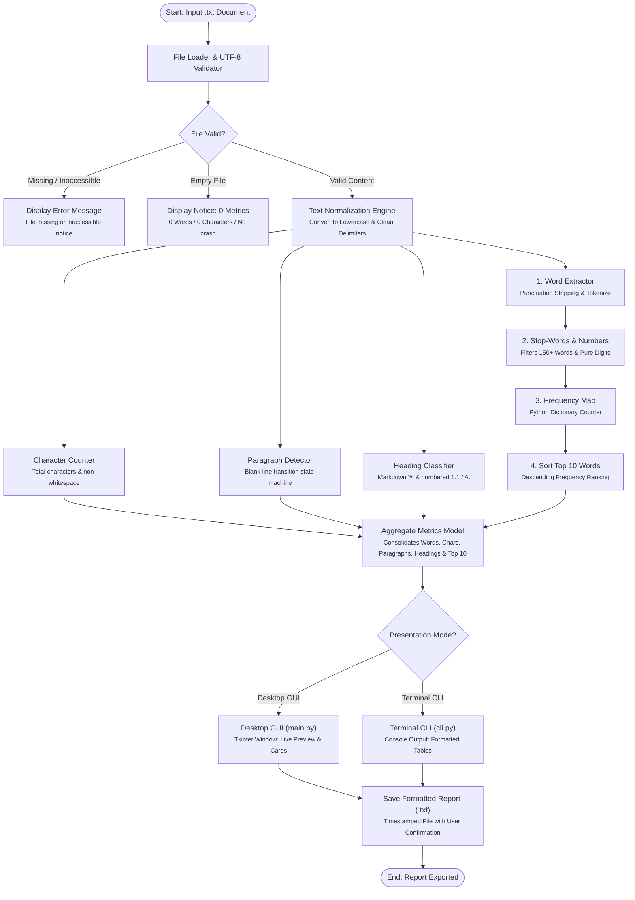

# Technical Document Analyzer

A lightweight desktop utility for analyzing plain-text technical documents and generating structured analysis reports. Built with Python 3 and Tkinter for a Technical Publications internship portfolio.

---

## 1. Project Purpose

Technical writers and engineering documentation teams frequently work with plain-text documentation, README files, release notes, and technical drafts. Understanding structural metrics (such as word volume, paragraph density, and section headings) along with prominent domain terminology helps writers assess document consistency and style adherence.

This project was developed to provide a straightforward, transparent analysis tool that operates completely offline using only standard Python libraries—without any external cloud services, web frameworks, or AI dependencies.

---

## 2. Features

- **Document Ingestion**:
  - Open any plain-text (`.txt`) file using the system file picker.
  - Safe UTF-8 file reading with clear error handling for missing, inaccessible, or invalidly encoded files.
- **Structural Analysis**:
  - Total word count (punctuation-cleaned alphanumeric tokens).
  - Total character count (including whitespace).
  - Character count excluding whitespace.
  - Non-empty paragraph count (blocks separated by blank lines).
  - Heading count (detects Markdown hashes `#` and numbered section headers `1.`, `1.1`, `A.`).
- **Frequent Term Extraction**:
  - Word frequency counting using a standard Python dictionary.
  - Filtering of common English stop words (e.g., *the*, *and*, *is*, *of*, *to*) and standalone numeric digits.
  - Display of the ten most frequent domain terms.
- **Report Generation**:
  - Export analysis results to a clean, formatted `.txt` report file.
  - Confirmation before overwriting any existing file.
  - Timestamps, source paths, metrics, and top terms included in output.
- **Minimal Desktop Interface**:
  - Simple, responsive desktop UI built with Tkinter.
  - Read-only preview pane to inspect loaded document content.
  - Disabled action states preventing operations before a document is loaded.
- **Optional Terminal CLI**:
  - Also includes `cli.py` for headless environments or terminal users.

---

## 3. Technologies Used

- **Language**: Python 3.9+ (tested on Python 3.13)
- **GUI Library**: `tkinter` and `tkinter.ttk` (standard Python library)
- **File & System Operations**: `os`, `re`, `string`, `datetime` (standard Python library)
- **Testing**: `unittest` (standard Python library)
- **Third-Party Dependencies**: None

---

## 4. Requirements

- A computer running Windows, macOS, or Linux.
- Python 3.9 or newer installed with standard Tkinter support.
- No external packages or `pip install` commands required.

---

## 5. Project File Structure

```text
c:/PythonProject/
│
├── main.py                     # Desktop GUI application (Tkinter interface)
├── cli.py                      # Optional terminal CLI interface
├── analyzer.py                 # Core text analysis & report generation logic
├── test_analyzer.py            # Automated unit tests for all features and edge cases
├── sample.txt                  # Quick-test technical document in root
├── README.md                   # Project documentation and user guide
├── .gitignore                  # Git exclusions for Python cache files
│
├── sample_documents/           # Realistic technical documents for testing
│   ├── arduino_sensor_system.txt
│   ├── software_install_guide.txt
│   └── network_packet_analyzer.txt
│
└── output/                     # Default directory for exported analysis reports (.txt)
    ├── README.txt
    ├── arduino_sensor_system_report.txt
    ├── software_install_guide_report.txt
    └── sample_report.txt
```

---

## 6. How to Run the Application

### Desktop GUI (Primary):
Open your terminal or command prompt, navigate to the project directory, and run:

```bash
python main.py
```

### Terminal CLI (Optional):
If you prefer running in the terminal without a GUI window:

```bash
python cli.py
```

### Automated Tests:
To run the automated test suite:

```bash
python test_analyzer.py -v
```

---

## 7. How to Use Main Features

1. **Load a Document**:
   - Click the **Browse Document...** button in the top bar.
   - Choose a `.txt` file (such as `sample.txt` or one of the files in `sample_documents/`).
   - The document path appears in the top field, the text is displayed in the preview pane, and analysis metrics calculate immediately.

2. **Inspect Metrics**:
   - The **Document Metrics** section displays total words, characters, paragraphs, and headings.
   - The **Top 10 Frequent Words** table lists the most common technical terms with their occurrence count.

3. **Export a Report**:
   - Click the **Save Analysis Report (.txt)** button at the bottom right.
   - Select a destination folder and filename (defaults to the `output/` directory).
   - If a file with that name already exists, the operating system asks for confirmation before replacing it.

4. **Reset**:
   - Click **Reset** in the top bar to clear all displayed data and disable the save button.

---

## 8. How Word Frequency Analysis Works

1. **Case Normalization**:
   The entire input text is converted to lowercase using `text.lower()`. This ensures words like `"Sensor"`, `"sensor"`, and `"SENSOR"` are recognized as the same word.

2. **Punctuation Stripping**:
   Punctuation marks from Python's standard `string.punctuation` (such as commas, colons, parentheses, slashes) are replaced with spaces. This cleanly separates joined words like `"status:active"` or `"sensor/switch"` into distinct tokens.

3. **Stop-Word Filtering**:
   The code splits the text into tokens and filters each token:
   - Tokens containing only digits (e.g., `"16"`, `"9600"`) are ignored.
   - Common grammatical words (stop words like `"the"`, `"and"`, `"with"`, `"for"`) are ignored using a predefined Python `set`.
   - Remaining domain words are kept.

4. **Dictionary Counting & Sorting**:
   A standard Python dictionary (`word_counts = {}`) stores the frequency:
   ```python
   for word in words:
       if word in word_counts:
           word_counts[word] += 1
       else:
           word_counts[word] = 1
   ```
   The dictionary items are then sorted by count in descending order:
   ```python
   sorted_words = sorted(word_counts.items(), key=lambda item: (-item[1], item[0]))
   top_10 = sorted_words[:10]
   ```

---

## 9. Example Input and Output

### Sample Input (`sample.txt`):
```text
# SAMPLE TECHNICAL DOCUMENT: NETWORK PACKET ANALYZER SPECIFICATION

## 1. System Overview
The Network Packet Analyzer is a modular software utility designed to capture, decode, and inspect Ethernet frames traversing a local network interface...
```

### Sample Output (`output/sample_report.txt`):
```text
==============================================================================
TECHNICAL DOCUMENT ANALYSIS REPORT
==============================================================================
Generated On      : 2026-10-29 02:45:00
Source Document   : sample.txt
Source Path       : sample.txt

------------------------------------------------------------------------------
1. BASIC METRICS
------------------------------------------------------------------------------
Total Words                     : 393
Total Characters (with spaces)  : 2,884
Characters (excluding spaces)   : 2,479
Non-Empty Paragraphs            : 7
Headings Detected               : 13

------------------------------------------------------------------------------
2. TOP 10 FREQUENT WORDS (Common English Stop Words Excluded)
------------------------------------------------------------------------------
Rank  Word                          Occurrences
----------------------------------------------
1     network                       13        
2     packet                        10        
3     capture                       8         
4     protocol                      8         
5     address                       5         
6     destination                   5         
7     interface                     4         
8     port                          4         
9     raw                           4         
10    source                        4         

------------------------------------------------------------------------------
3. ANALYSIS NOTES & LIMITATIONS
------------------------------------------------------------------------------
- Headings are detected using Markdown prefixes ('# ') and numbered section prefixes
  (e.g., '1. Introduction', '1.1 System Architecture', 'A. Overview').
- Numbered list items in plain text that share this formatting may also be counted.
- Common English stop words (such as 'the', 'is', 'and', 'to') and numeric digits
  are omitted from the top frequent words list.
==============================================================================
End of Report
==============================================================================
```

---

## 10. Limitations

1. **Plain-Text Only**: The tool accepts `.txt` files. It does not parse binary formats like `.docx`, `.pdf`, or scanned images.
2. **Rule-Based Heading Detection**: Headings are detected based on Markdown prefixes (`# `, `## `) or numbered prefixes (`1. `, `1.1 `, `A. `). Numbered procedure steps in plain text that share this prefix pattern will also be counted as headings.
3. **English Stop Words**: The stop word list covers standard English.
4. **Stemming**: Words are matched by exact spelling after lowercasing. Grammatical variants (e.g., `"sensor"` and `"sensors"`) are treated as two separate dictionary keys.

---

## 11. System Architecture and Workflow Diagram

The complete end-to-end processing pipeline is illustrated below. High-resolution standalone diagram assets are available in the repository:
- Vector graphic (infinite zoom, zero blurriness): [flowchart_diagram.svg](file:///c:/PythonProject/flowchart_diagram.svg)
- Ultra high-resolution 300-DPI raster: [flowchart_diagram.png](file:///c:/PythonProject/flowchart_diagram.png)

### Mermaid Diagram (Copy-Paste for Mermaid.ai / Mermaid Live Editor):



